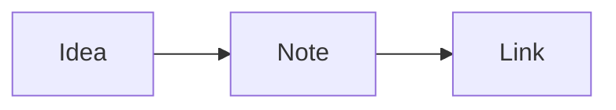

# Markdown syntax

## Text

**Bold** with `**bold**`, *italic* with `*italic*`, ~~strikethrough~~ with `~~text~~`, ==highlight== with `==text==`, and `inline code` with backticks. %%Comments like this one%% are hidden outside Source mode: `%%comment%%`.

## Headings, lists and tasks

Start a line with `#` to `######` for headings. Lists start with `-`, `*` or `1.`.

- [ ] An open task: `- [ ] task`
- [x] A finished task: `- [x] task` (click the box to tick it)

## Quotes and callouts

> A quote starts with `>`.

> [!note] Callouts
> Start a quote with `[!note]`, `[!tip]`, `[!warning]` and more. Add `-` after the type to fold it: `> [!info]-`.

## Tables

| Fruit | Count |
| :---- | ----: |
| Apple | 3 |
| Pear | 12 |

Inside a table, **Tab** and **Shift+Tab** move between cells and line the columns up.

## Code, maths and diagrams

```js
const greeting = 'Code blocks are highlighted in their language'
```

Maths uses KaTeX: inline $e^{i\pi} + 1 = 0$ and blocks:

$$
\int_0^1 x^2\,dx = \frac{1}{3}
$$



## Footnotes and tags

A footnote[^1] goes at the bottom. Tags like #help mark notes; click one to search for it.

[^1]: Like this one.
