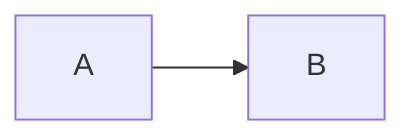

# Formatting

See [[Ideas]] and ==this highlight==.

> [!note] A callout
> With body text.

- [ ] An open task
- [x] A finished task

| Fruit | Count |
| --- | --- |
| Apple | 3 |

Inline math $a^2 + b^2$ here.

$$
x = \frac{1}{2}
$$

![[Ideas]]
